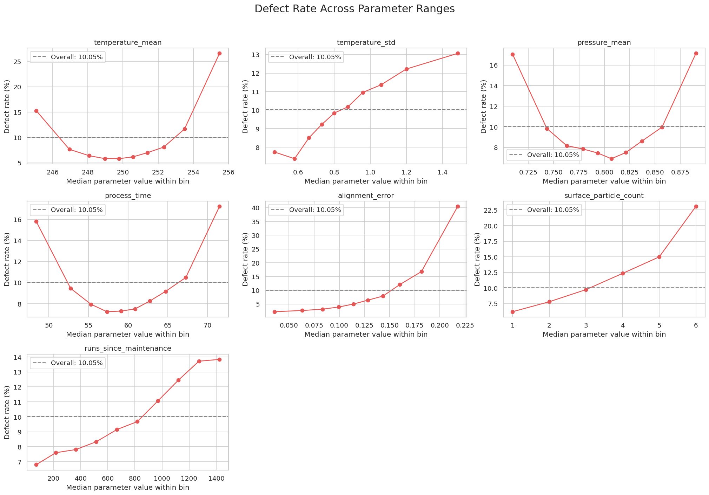
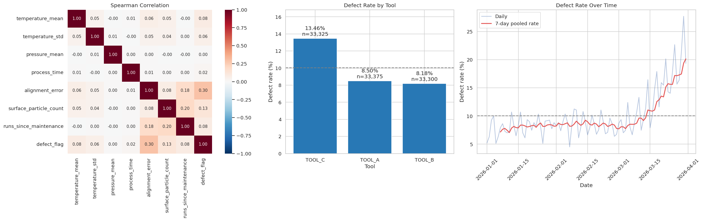
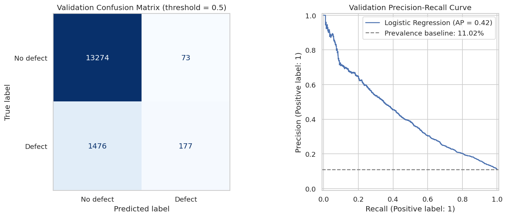
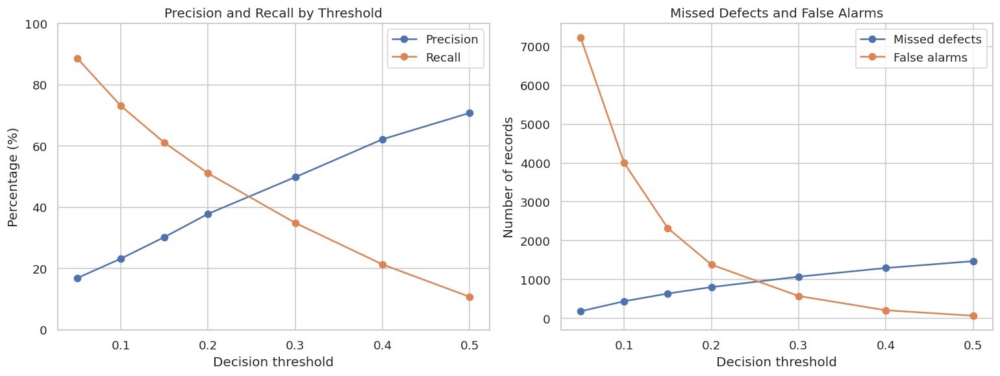
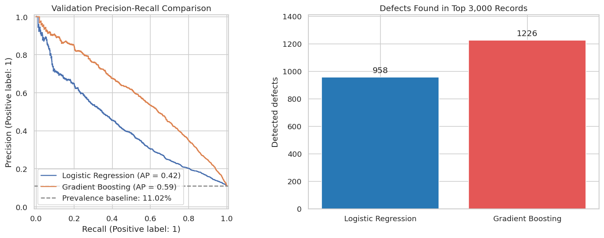
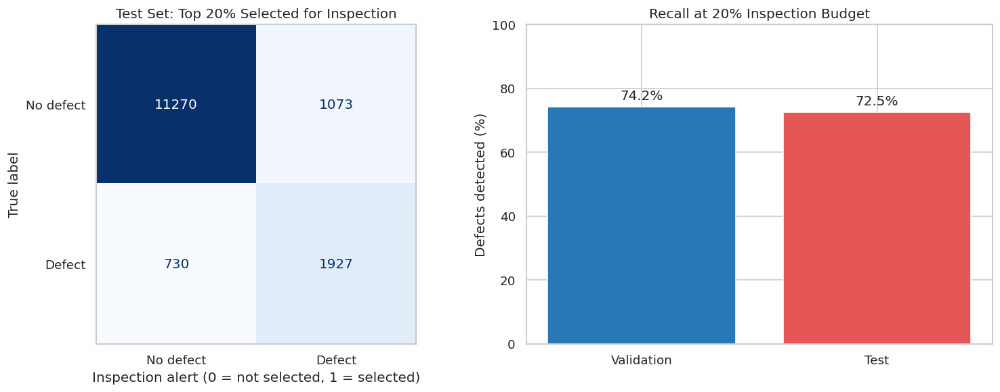
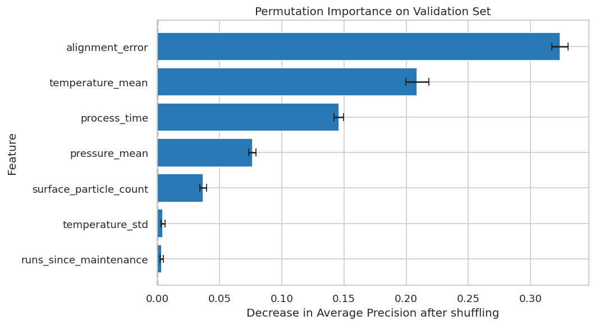
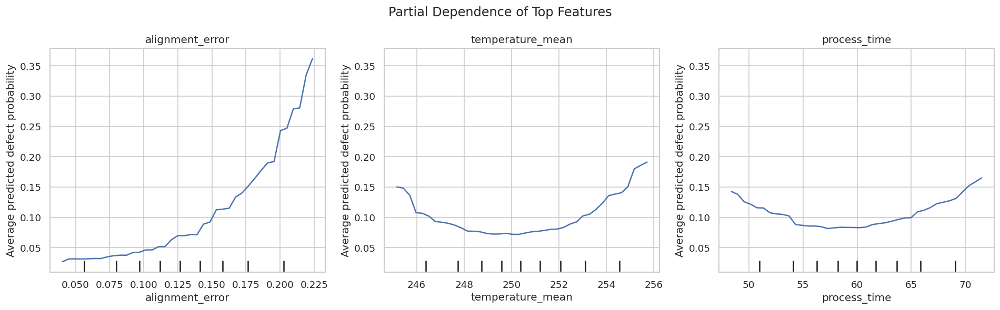

# SoIC Bonding Quality Risk Prediction

[繁體中文](README.zh-TW.md) · [PowerPoint](presentations/SoIC_Process_Engineer_Briefing_ZH.pptx) · [Slide notes](presentations/SPEAKER_NOTES.zh-TW.md) · [Open in Colab](https://colab.research.google.com/github/chelsietao/soic-bonding-quality-risk-prediction/blob/main/notebooks/SoIC_Bonding_01_EDA.ipynb)

## 1. Overview

This project analyzes **100,000 synthetic bonding records**, using process measurements to rank records by defect risk. The workflow combines exploratory analysis, chronological lot separation, Logistic Regression, gradient boosting and model interpretation, with an evaluation policy that selects the highest-scoring 20% of records for inspection.

On the 15,000-record test set, the model selects 3,000 records containing **1,927 of 2,657 defects**. The resulting **precision is 64.2%, recall is 72.5% and enrichment over random selection is 3.63 times**, with 730 defects in the remaining 12,000 records.

The engineering question is: **when inspection capacity covers 20% of a completed processing cohort, how many defect-labeled records can a risk ranking place in that selection?** The 20% fraction is the evaluation budget chosen for this project.

The analysis connects process variation to record-level review. Parameter plots identify ranges associated with higher observed defect rates, equipment and time plots locate concentrations, and the model combines seven measurements into one ranking. The selected records retain wafer, lot, tool and timestamp references for traceability.

All eight Colab figure groups appear below, covering 22 analytical panels. The PowerPoint includes every panel, with enlarged views and numerical interpretation. `images/colab/index.json` maps the source figures to the slides.

## 2. Data and prediction point

Each row represents a synthetic wafer processing record, with seven numerical process features and a binary defect label. The dataset spans January through March 2026 in UTC+08:00, containing 4,000 lots, three tools and 10,046 defect labels, for a defect rate of 10.046%.

| Fields | Meaning | Use |
|---|---|---|
| `wafer_id`, `lot_id` | Wafer and lot identifiers | Traceability and lot separation |
| `timestamp`, `tool_id` | Processing timestamp and tool identifier | Time and equipment stratification |
| `temperature_mean`, `temperature_std` | Mean temperature and within-record variation | Model inputs |
| `pressure_mean`, `process_time` | Mean pressure and processing duration | Model inputs |
| `alignment_error` | Recorded alignment error | Model input |
| `surface_particle_count` | Recorded surface particle count | Model input |
| `runs_since_maintenance` | Runs accumulated since maintenance | Model input |
| `defect_flag` | 0: no defect, 1: defect | Prediction target |

The prediction point is after the recorded processing step and before quality inspection, so the process summaries are available for scoring. Parameter plots retain the numerical scales recorded in the CSV. The model uses the seven numerical features. Identifiers, timestamps and tool IDs support splitting and stratified analysis.

`pd.to_datetime()` parses timestamps, numeric conversion validates the seven inputs, and `assert` checks the target labels. `isna()`, `duplicated()` and `describe()` produce completeness, duplication and distribution summaries, with zero missing cells and zero fully duplicated rows in the fixed input.

## 3. Parameter ranges and observed defect rates



`pd.qcut(feature, q=10, duplicates="drop")` divides each feature into up to ten approximately equal-count groups, and `groupby().agg()` computes the group median, sample count, defect count and defect rate.

The X coordinate is the **feature median within a group**, while the Y coordinate is **group defect count divided by group record count**. For the lowest temperature group, the median is about 245.07 and 1,530 of 10,000 records have defects, producing the point **(245.07, 15.30%)**. Tied integer values produce fewer quantile bins, with six groups in the particle-count plot.

| Panel | Observed pattern | Approximate reading |
|---|---|---|
| Mean temperature | U-shaped | Middle groups around 6%, lowest group 15.3%, highest group around 27% |
| Temperature variation | Increasing across most groups | About 7.5% to 13% |
| Mean pressure | U-shaped | Middle groups around 7%, extremes around 17% |
| Process time | U-shaped | Middle groups around 7%, extremes around 16–17% |
| Alignment error | Rising, steeper at the upper end | About 2% in the lowest group and 40% in the highest |
| Particle count | Rising | About 6% at group median 1 and 23% at median 6 |
| Runs since maintenance | Rising | About 7% to 14% |

The dashed line is the dataset defect rate of 10.05%, providing a common reference for all seven panels. These curves motivate the choice of a model that can represent both monotonic and U-shaped patterns, with values above read from the plotted groups.

## 4. Correlation, equipment and time



### Spearman correlation

The heatmap compares rank direction for each pair of columns, with positive values indicating that larger values tend to occur together. In the `defect_flag` row, alignment error has a coefficient of about **0.30**, particle count about **0.13**, and mean pressure about **0.00**. The pressure-bin curve shows a U shape, explaining why a directional rank statistic and a range-based analysis describe different aspects of the same data.

### Tool-level defect rate

`groupby("tool_id")` computes the mean label within each tool, while the labels show the record counts used as denominators.

| Tool | Records | Defect rate |
|---|---:|---:|
| TOOL_C | 33,325 | 13.46% |
| TOOL_A | 33,375 | 8.50% |
| TOOL_B | 33,300 | 8.18% |

TOOL_C has the highest observed defect rate, 4.96 percentage points above TOOL_A, identifying a useful equipment stratum for further data review.

### Time trend

`resample("D")` counts defects and records by day, while `rolling(7)` pools the last seven days of counts before computing a rate. The pale line shows daily variation, and the red line rises from roughly 8–9% in January and February to about 20% near the end of March, establishing the motivation for chronological evaluation.

## 5. Chronological split and models

Lots are ordered by their earliest timestamps, then assigned to training, validation and test sets. Whole lots remain together, with assertions confirming non-overlapping time ranges in the fixed dataset.

| Dataset | Records | Lots | Defect rate | Use |
|---|---:|---:|---:|---|
| Train | 70,000 | 2,800 | 8.19% | Learn preprocessing and model parameters |
| Validation | 15,000 | 600 | 11.02% | Compare models and inspection rules |
| Test | 15,000 | 600 | 17.71% | Evaluate the fixed tree model and 20% policy |

Training covers January 1 through March 4. Validation covers March 5 through March 18 at 11:58:42, and testing starts March 18 at 12:00:00 and ends March 31, all in UTC+08:00. The model therefore learns from earlier records and ranks later records. Training-fitted preprocessing keeps validation and test values out of the learned imputation and scaling statistics.

The Logistic Regression pipeline combines training-fitted median imputation and standardization, followed by `LogisticRegression(max_iter=1000)`. The tree model uses the same seven numerical inputs, with `HistGradientBoostingClassifier(learning_rate=0.05, max_iter=200, max_leaf_nodes=15, min_samples_leaf=50, l2_regularization=1.0, early_stopping=False, random_state=42)`.

Logistic Regression forms a linear combination on the log-odds scale, while gradient boosting partitions feature ranges through successive trees. This provides a method comparison under a shared input set, training split and validation inspection capacity.

## 6. Baseline validation results



The confusion matrix uses a probability threshold of 0.50, with actual labels on rows and predicted labels on columns.

| Actual label | Predicted no defect | Predicted defect |
|---|---:|---:|
| No defect | 13,274 | 73 |
| Defect | 1,476 | 177 |

The model flags 250 records, including 177 defects and 73 non-defects. **Precision = 177 / 250 = 70.8%**, while **Recall = 177 / 1,653 = 10.7%**, showing the coverage at this operating threshold.

On the Precision-Recall curve, each location represents a different threshold, with recall on X and precision on Y. The dashed 11.02% line is validation prevalence, and AP is **0.421**, summarizing the ranking across thresholds.

## 7. Threshold sensitivity



The left panel compares precision and recall by threshold, and the right panel shows missed defects and false alarms as record counts. The threshold table supplies the workload behind each point, with all numbers from the Logistic Regression validation experiment.

| Threshold | Precision | Recall | Detected | Missed | False alarms | Alerts |
|---|---:|---:|---:|---:|---:|---:|
| 0.05 | 16.8% | 88.6% | 1,465 | 188 | 7,232 | 8,697 |
| 0.10 | 23.2% | 73.1% | 1,208 | 445 | 4,001 | 5,209 |
| 0.15 | 30.2% | 61.0% | 1,009 | 644 | 2,327 | 3,336 |
| 0.20 | 37.8% | 51.1% | 844 | 809 | 1,387 | 2,231 |
| 0.30 | 49.8% | 34.8% | 576 | 1,077 | 580 | 1,156 |
| 0.40 | 62.2% | 21.3% | 352 | 1,301 | 214 | 566 |
| 0.50 | 70.8% | 10.7% | 177 | 1,476 | 73 | 250 |

Changing the threshold from 0.50 to 0.10 covers **1,031 additional defects**, adding 3,928 false alarms and 4,959 alerts. This quantifies the coverage/workload decision, with model scores held fixed.

## 8. Model comparison at the same inspection capacity



The comparison selects the highest-scoring **3,000 of 15,000 validation records** for each model, using `np.argsort(-scores, kind="stable")`. A 20% inspection fraction selects a fixed number of records, whereas a probability threshold selects records whose scores exceed a particular value. Here the full validation set is one evaluation cohort, and the full test set is another. For each cohort, the selection count is `ceil(0.20 × N)`, scores are sorted from largest to smallest, and tied scores retain their original row order.

| Model | AP | ROC-AUC | Defects covered | Defects outside selection | Precision | Recall |
|---|---:|---:|---:|---:|---:|---:|
| Logistic Regression | 0.421 | 0.794 | 958 | 695 | 31.9% | 58.0% |
| Gradient Boosting | 0.593 | 0.887 | 1,226 | 427 | 40.9% | 74.2% |

Gradient boosting covers **268 additional defects**, with the number outside selection falling by **268 / 695 = 38.6%**. The orange PR curve lies above the baseline across most of the displayed range, consistent with higher AP and greater defect coverage at the shared capacity.

## 9. Test evaluation



The trained tree model ranks test records, and the 20% policy selects 3,000 records before evaluation against their labels.

| Actual label | Outside selection | Within selection |
|---|---:|---:|
| No defect | 11,270 | 1,073 |
| Defect | 730 | 1,927 |

| Metric | Validation | Test |
|---|---:|---:|
| Defect prevalence | 11.02% | 17.71% |
| AP | 0.593 | 0.756 |
| ROC-AUC | 0.887 | 0.912 |
| Precision at top 20% | 40.9% | 64.2% |
| Recall at top 20% | 74.2% | 72.5% |

Test recall is **1.7 percentage points** below validation recall, with both sets using the same selection fraction. The test subset has **64.2% defects**, compared with 17.71% in the full test population, giving **lift = (1,927 / 3,000) / (2,657 / 15,000) = 3.63**. Random selection would cover 531.4 defects in expectation, and the unselected group's defect rate is 730 / 12,000 = **6.08%**.

AP and precision depend on prevalence as well as ranking, so the evaluation presents prevalence, ROC-AUC and fixed-capacity recall together. The reported result corresponds to this synthetic dataset, chronological split and selection policy.

## 10. Feature importance



Permutation importance shuffles one validation feature at a time, using the mean AP decrease over five repeats. The X axis measures AP decrease, and the short horizontal error bars show repeat standard deviations.

| Feature | Mean AP decrease | Repeat standard deviation |
|---|---:|---:|
| Alignment error | 0.3237 | 0.0065 |
| Mean temperature | 0.2090 | 0.0092 |
| Process time | 0.1459 | 0.0038 |
| Mean pressure | 0.0765 | 0.0030 |
| Particle count | 0.0369 | 0.0027 |
| Temperature variation | 0.0046 | 0.0017 |
| Runs since maintenance | 0.0036 | 0.0012 |

Shuffling alignment error reduces AP from about **0.593 to 0.269**, making it the strongest dependency in this model. Mean temperature and process time follow, with importance measuring each feature's contribution to the fixed model under the available input set.

## 11. Partial dependence



The notebook replaces one feature across validation records and averages the resulting predicted probabilities, using 40 grid values between the 5th and 95th percentiles. X represents the assigned feature value, Y represents the average model response, and the bottom marks indicate feature deciles.

| Feature | Approximate model response | Interpretation |
|---|---|---|
| Alignment error | About 3% at 0.05, 9% at 0.15, 24% at 0.20 and 36% at 0.22 | Predicted risk rises toward the upper range |
| Mean temperature | About 7% near 249–250, 15% near 245 and 19% near 255.7 | U-shaped response with a lower middle region |
| Process time | About 8% near 57–60, 14% near 48.5 and 16% near 71.5 | U-shaped response with higher ends |

These readings describe the fitted model's response to feature replacement, with group defect-rate curves in Section 3 providing the corresponding observed-data view. The two views use different calculations: grouped rates count observed labels within a range, while PDP averages model outputs after replacing a feature across records.

## 12. Inspection selection and traceability

The scoring sequence follows the information available at the prediction point:

1. Collect the seven recorded process measurements after the processing step.
2. Apply the trained model to obtain a defect-class score for every record in the cohort.
3. Rank the scores and select `ceil(0.20 × N)` records.
4. Link selected positions back to `wafer_id`, `lot_id`, `tool_id` and `timestamp`.
5. Compare the selection with inspection labels to calculate selected defects, false alerts and defects outside the selection.

For the test cohort, this sequence produces 3,000 selected records: 1,927 defect-labeled records and 1,073 records labeled no defect. The remaining 12,000 contain 730 defect labels. These counts describe the complete allocation of the 15,000 test records.

The following example creates a traceable review table from a completed cohort. `risk_score` is the model output used for ranking.

```python
import numpy as np

review = records[["wafer_id", "lot_id", "tool_id", "timestamp"]].copy()
review["risk_score"] = model.predict_proba(records[metadata["features"]])[:, 1]
positions = np.argsort(-review["risk_score"].to_numpy(), kind="stable")
k = int(np.ceil(len(review) * 0.20))
inspection_list = review.iloc[positions[:k]].copy()
inspection_list.insert(0, "risk_rank", np.arange(1, k + 1))
```

## 13. Process and equipment review

Each result supports a specific review question. Keeping the observed result next to the associated records makes the discussion reproducible.

| Analysis evidence | Review question | Records to compare |
|---|---|---|
| TOOL_C observed defect rate is 13.46% | Is the tool difference also visible within comparable time windows? | Tool, timestamp, seven inputs and inspection labels |
| The pooled defect rate rises late in March | Which parameter distributions change in the same period? | Daily record counts, daily defects and parameter summaries |
| Alignment error has the largest permutation AP drop | How do high-score records differ in recorded alignment error? | Selected records versus the rest of the same cohort |
| Temperature and duration show U-shaped patterns | Are both low and high ranges represented in selected records? | Quantile-bin counts, observed rates and model scores |
| Defects remain outside the top 20% | Which patterns occur among the 730 unselected test defects? | Labels and process inputs for the unselected group |

The tool and time summaries report quality rates with their sample counts. Permutation importance ranks model dependencies, and PDP describes the fitted response shape. Together they supply complementary evidence for process-data review.

## 14. Code flow, metrics and reproduction

| Step | Code | Output |
|---|---|---|
| Validate | `read_csv`, `to_datetime`, `assert`, `describe` | Input checks and numerical summaries |
| Explore | `qcut`, `groupby`, `resample`, `corr` | Parameter, equipment and time figures |
| Split | Ordered lot timestamps and `.isin()` | Train/validation/test records |
| Fit | `Pipeline.fit`, `HistGradientBoostingClassifier.fit` | Two fitted models |
| Score/select | `predict_proba`, `argsort` | Risk scores and inspection indices |
| Evaluate | AP, ROC-AUC and count-based metrics | Tables and comparison figures |
| Explain | `permutation_importance`, `PartialDependenceDisplay` | Model dependency and response plots |

Precision uses TP / (TP + FP), recall uses TP / (TP + FN), and alert rate uses selected records / all records. AP summarizes precision over changes in recall, while ROC-AUC measures pairwise ranking discrimination, counting tied scores as half.

Open the notebook in Colab, upload `data/synthetic_bonding_data.csv`, and execute cells in order. Saved tables in `results/` preserve numerical results, and all eight executed figures are in `images/colab/`. The model and metadata are in `models/`, with scikit-learn 1.6.1, NumPy 2.1.3, pandas 2.2.3 and joblib 1.6.0 recorded for the saved model.

```python
import json
import joblib
import numpy as np

with open("models/model_metadata.json", encoding="utf-8") as f:
    metadata = json.load(f)
model = joblib.load("models/bonding_risk_model.joblib")
scores = model.predict_proba(records[metadata["features"]])[:, 1]
k = int(np.ceil(len(scores) * 0.20))
selected_positions = np.argsort(-scores, kind="stable")[:k]
```

Here `records` is a numerical batch DataFrame, and `selected_positions` contains positional row indices.

```text
notebooks/       Colab source
data/            Synthetic CSV and checksum
models/          Saved tree model and metadata
results/         Numerical evaluation tables
images/colab/    All eight executed figure groups and slide index
presentations/   PowerPoint and slide notes
```
