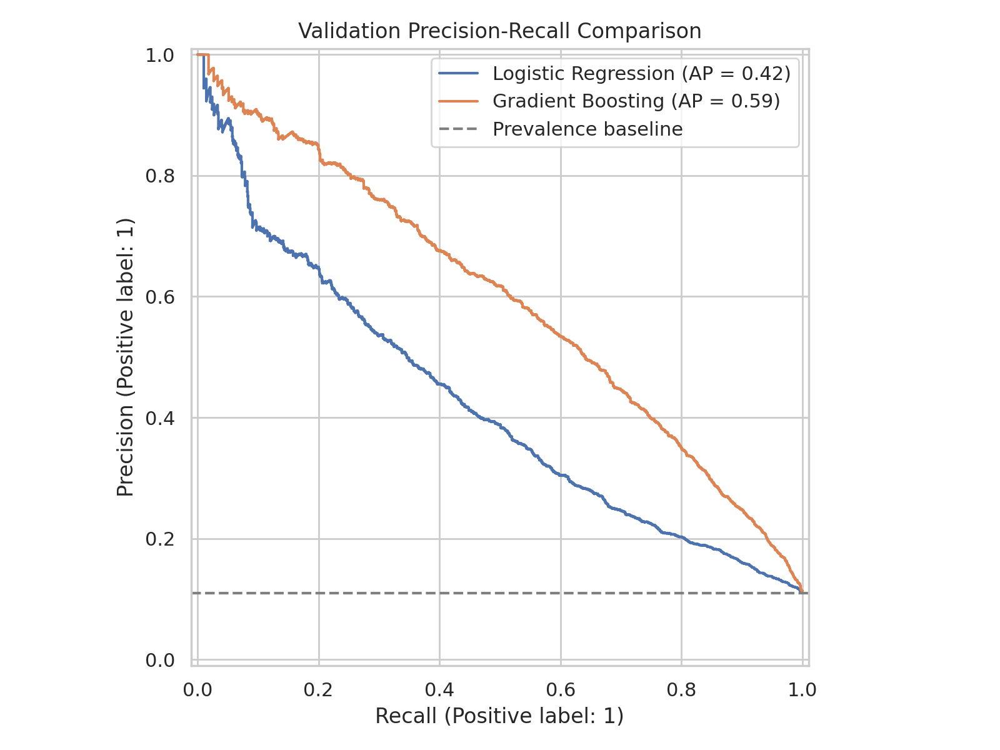
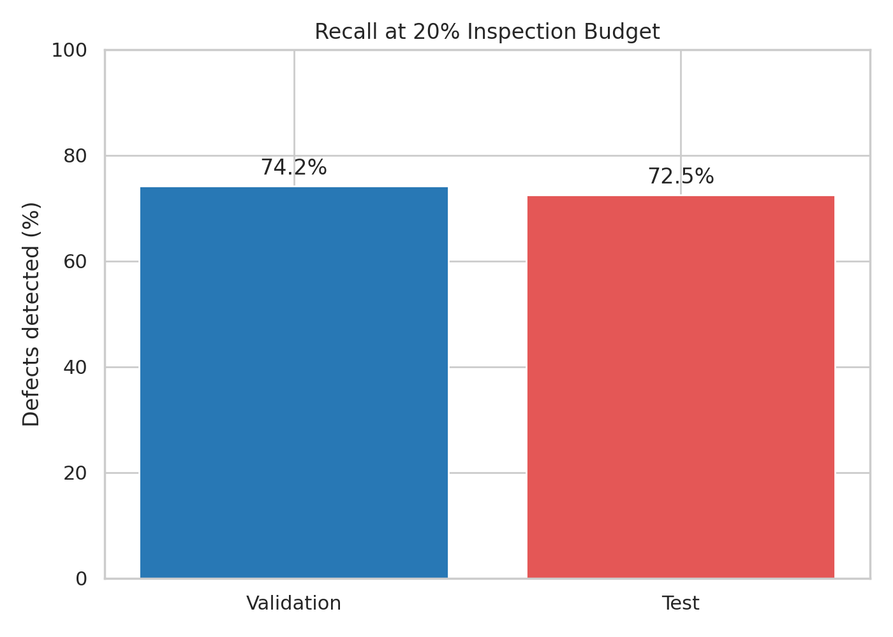
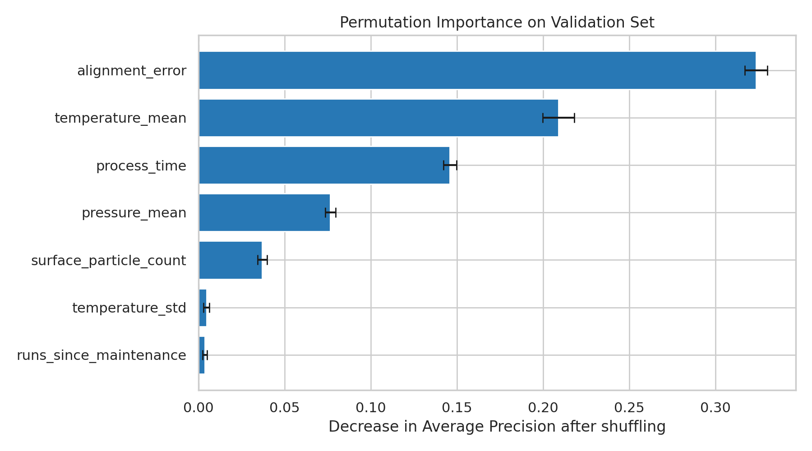
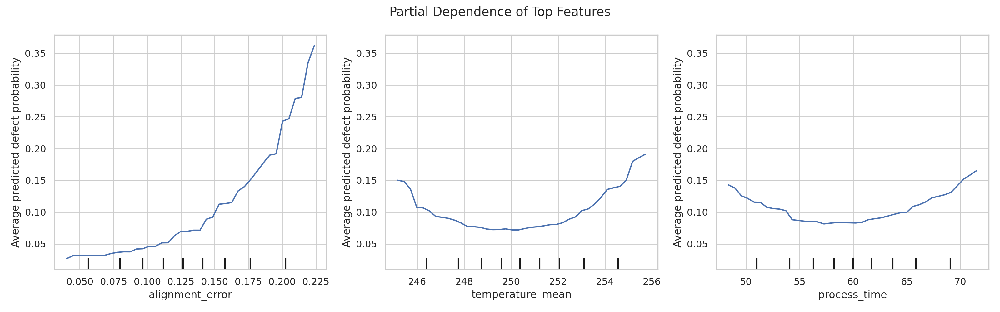

# SoIC 鍵合品質風險預測

[English README](README.md) · [中文簡報](presentations/SoIC_Process_Engineer_Briefing_ZH.pptx) · [Colab 筆記本](https://colab.research.google.com/github/chelsietao/soic-bonding-quality-risk-prediction/blob/main/notebooks/SoIC_Bonding_01_EDA.ipynb)

## 一、專題概述

本專題使用鍵合加工的模擬資料建立缺陷風險排序模型，研究在檢查資源有限的情況下，如何優先選取較可能存在缺陷的紀錄，並透過時間切分評估後續期間的預測表現，再以模型解釋整理製程調查與實驗驗證的候選方向。

在 15,000 筆測試紀錄中，模型選取風險最高的 20%，涵蓋 72.5% 的缺陷，檢查命中率為 64.2%，結果反映這份模擬資料上的檢查排序成效，真實製程應用仍需確認參數單位、缺陷定義與設備資料。

## 二、製程工程應用範圍

鍵合品質分析需要將製程參數、設備狀態與品質量測連結，本專題透過 Python 資料處理與機器學習建立分析流程，並將結果整理為可追溯的評估紀錄，支持製程維持、設備排查及跨團隊技術討論。

| 應用範圍 | 已完成的分析 | 後續驗證條件 |
|---|---|---|
| 製程開發與改善 | 分析參數區間與缺陷關聯，形成候選假設 | 量測系統與核准的實體實驗 |
| 日常維持與設備排查 | 依機台與時間觀察品質差異，界定追查範圍 | 腔體、配方、產品與維修紀錄 |
| 跨部門技術協作 | 保存共同指標、分析方法與結果，建立證據脈絡 | 現場責任分工及處置完成條件 |
| SPC／DOE | 設計監控與實驗驗證的銜接方式 | 正式管制圖與實驗執行資料 |
| Python 與模型應用 | 建立模型比較、評估與解釋流程，保存版本 | 生產資料驗證與持續監控 |
| 跨廠方法移轉 | 提供雙語技術文件，定義資料與版本交接內容 | 當地設備、配方與量測流程的一致性確認 |

目前成果涵蓋資料分析與方法驗證，實際製程決策仍需要物理、化學、設備與量測證據支持，模型分析與現場工程調查應使用一致的紀錄定義與品質規範。

## 三、專題問題與預測時點

假設品質檢查只能涵蓋某一批紀錄的 20%，模型將每筆紀錄排序，協助工程師決定先檢查哪些紀錄，後續再用品質標籤評估排序成效。

預測時點設定在「紀錄中的加工步驟完成、品質檢查之前」，因為平均溫度、溫度波動與加工時間都是加工後才能取得的摘要，若目標改成加工前預警，這些欄位需要重新檢查可用時間，避免使用未來資訊。

分析單位是一片晶圓的一次模擬加工紀錄，模型輸出是缺陷風險分數，最後的動作是排定檢查優先序，是否攔貨、停機、放行或修改配方，需要依工廠規範及負責人的權責決定。

## 四、資料內容與單位問題

資料共有 **100,000 筆、12 欄、4,000 個批次與 3 台機台**，時間涵蓋 2026 年一月至三月，缺陷紀錄共 **10,046 筆**，整體缺陷率為 **10.046%**，目前固定輸入檔的缺失值與完全重複列數皆為零。

| 欄位 | 中文意義 | 在分析中的用途 | 尚需定義的內容 |
|---|---|---|---|
| `wafer_id` | 晶圓編號 | 追溯加工紀錄 | 真實系統的識別與重工規則 |
| `timestamp` | 加工時間戳記 | 時間切分與趨勢觀察 | 起始或結束時間的定義，現有時區為 UTC+08:00 |
| `lot_id` | 批次編號 | 避免同批次跨資料集 | 真實批次關聯與產品別 |
| `tool_id` | 機台編號 | 比較各機台觀察結果 | 腔體、機型及配方脈絡 |
| `temperature_mean` | 平均溫度 | 模型輸入 | 攝氏或其他尺度、感測器位置與取樣期間 |
| `temperature_std` | 溫度標準差 | 模型輸入 | 溫度尺度、取樣頻率與計算方式 |
| `pressure_mean` | 平均壓力 | 模型輸入 | 壓力種類、單位及量測位置 |
| `process_time` | 加工持續時間 | 模型輸入 | 秒、分鐘或其他尺度，以及加工步驟邊界 |
| `alignment_error` | 加工前對準誤差 | 模型輸入 | 單位、方向、向量或誤差量值定義 |
| `surface_particle_count` | 加工前表面粒子數 | 模型輸入 | 計數面積、粒徑門檻與量測方法 |
| `runs_since_maintenance` | 維修後累積加工次數 | 模型輸入 | 維修種類、計數重設及設備層級 |
| `defect_flag` | 缺陷標籤 | 預測答案 | 缺陷種類、檢測方法、嚴重度及標籤延遲 |

平均溫度約為 250，但原始生成流程未記錄物理單位與加工步驟，因此文件保留「單位未定義」，這個數值不能直接標成實際 SoIC 製程溫度，也不能據此推論鍵合或退火配方。

粒子數與加工次數可從欄位語義辨識為計數，量測面積與維修重設規則仍未定義，不能把不同量測條件的計數混在一起比較。

目前資料生成原始碼未納入儲存庫，因此重現方式是使用已保存的 CSV 與 SHA-256 校驗碼，能重現分析輸入，尚無法從生成程式重建每一筆模擬紀錄。

## 五、探索性分析在回答什麼

### 5.1 參數區間與缺陷率

程式先以 `pd.qcut(..., q=10, duplicates="drop")` 將參數排序並分成最多十個樣本數接近的區間，再以 `groupby().agg()` 計算每組的紀錄數、缺陷數與缺陷率，目的是觀察參數的不同範圍對應怎樣的品質結果。

圖中的每個點代表一組紀錄，X 軸使用該組參數中位數，Y 軸使用該組缺陷數除以紀錄數，例如最低溫組的 10,000 筆紀錄中有 1,530 筆缺陷，中位數約為 245.07，所以紅點表示 **X＝245.07、Y＝15.30%**，並非單片晶圓的座標。

資料顯示平均溫度、平均壓力與加工時間呈 U 形關係，對準誤差與粒子數增加時缺陷率上升，這些結果可形成候選假設，單一欄位的分組仍混合了其他條件的差異，無法據此認定因果。

### 5.2 Spearman 相關係數

Spearman 檢查兩個欄位排名變化的方向，係數接近 +1 代表同方向、接近 −1 代表反方向，接近零代表缺乏一致的單調方向，當參數與缺陷率呈 U 形時，前半段下降與後半段上升可能使係數接近零。

對準誤差與缺陷標籤的係數約為 0.30，代表有缺陷紀錄的對準誤差排名傾向較高，這個 0.30 是關聯係數，不能當作 30% 缺陷率。

### 5.3 機台差異與時間變化

TOOL_C 的觀察缺陷率為 13.46%，TOOL_A 為 8.50%，TOOL_B 為 8.18%，這可以作為機台分層調查的起點，接著需要檢查產品、配方、加工時間與上游條件，才能判斷差異是否來自設備。

一月至二月的七天缺陷率約為 8%～9%，三月後期有上升趨勢，這提示後續資料分布可能改變，也說明模型評估應保留時間順序，現有折線圖只有描述趨勢，尚未建立 SPC 管制界限。

## 六、時間切分與資料洩漏

程式依各批次最早時間排序，前 70% 批次放入訓練集，中間 15% 放入驗證集，最後 15% 放入測試集，同一批次只出現在一個資料集，再以斷言確認三份資料的時間範圍沒有重疊。

| 資料集 | 紀錄數 | 批次數 | 缺陷率 | 主要用途 |
|---|---:|---:|---:|---|
| 訓練集 | 70,000 | 2,800 | 8.19% | 學習前處理與模型參數 |
| 驗證集 | 15,000 | 600 | 11.02% | 比較模型與檢查政策 |
| 測試集 | 15,000 | 600 | 17.71% | 評估固定版本與固定政策 |

製程紀錄可能有同批次相似性與時間漂移，保留批次與時間順序能降低把相近紀錄混入訓練與評估的問題，若換成跨時段的真實批次，仍須重新檢查邊界，現有斷言不能保證所有新資料都適用。

本專題先看過全期間 EDA，再建立時間保留集，因此測試屬於學習型 holdout 評估，正式確認研究需要另外保留未被探索的新期間資料，之後若依測試結果修改模型，也需要新的確認資料。

## 七、兩個模型的設計與程式意圖

### 7.1 Logistic Regression 基準模型

`SimpleImputer(strategy="median")` 使用訓練集中位數處理缺值，雖然固定資料目前沒有缺值，保留這個步驟可以明確規範前處理，`StandardScaler()` 再以訓練集平均值與標準差調整尺度，最後由 Logistic Regression 學習參數與缺陷的關聯。

基準模型對輸入特徵建立線性的 log-odds 組合，若沒有另行加入平方項或其他轉換，就不容易表達「中間風險低、兩端風險高」的 U 形規律，這是引入樹模型的動機。

### 7.2 梯度提升樹模型

`HistGradientBoostingClassifier` 透過一系列樹模型累積修正預測，依數值區間切分資料，能表達非線性關係與參數間的交互作用，本專題使用相同七個數值參數，讓比較聚焦在模型方法。

| 設定 | 使用值 | 用途 |
|---|---:|---|
| `learning_rate` | 0.05 | 控制每一步新增模型的影響幅度 |
| `max_iter` | 200 | 設定提升迭代次數 |
| `max_leaf_nodes` | 15 | 限制每棵樹的葉節點數 |
| `min_samples_leaf` | 50 | 限制葉節點最少樣本數 |
| `l2_regularization` | 1.0 | 對模型複雜度加入正則化 |
| `early_stopping` | False | 使用設定的迭代次數，未另外切出內部早停集 |
| `random_state` | 42 | 固定涉及隨機性的設定，協助重現 |

這些設定是目前使用的一組配置，專題沒有做完整超參數搜尋，因此不能宣稱已找到最佳模型，輸出的機率也尚未做校準檢查，現階段以排序用途為主。

## 八、評估指標與工程意義

| 指標 | 公式或定義 | 製程情境中的解讀 |
|---|---|---|
| Precision | TP ÷（TP＋FP） | 送去檢查的紀錄中，有多少比例有缺陷 |
| Recall | TP ÷（TP＋FN） | 所有有缺陷紀錄中，檢查清單涵蓋多少比例 |
| Alert rate | 警報數 ÷ 全部紀錄數 | 需要檢查多少比例的紀錄 |
| AP | 彙整不同門檻下的 Precision／Recall | 缺陷是否集中在高分端 |
| ROC-AUC | 缺陷分數高於無缺陷分數的配對判別程度，平手計半 | 整體風險排序的區分能力 |
| Lift | Precision ÷ 原始缺陷率 | 相對隨機選取，清單中缺陷濃度提高多少 |

TP 是有缺陷且被選中，FP 是無缺陷卻被選中，FN 是有缺陷卻未被選中，TN 是無缺陷且未被選中，這裡描述的是紀錄選取，實際檢查能否辨識缺陷還取決於檢測系統。

模型在 0.50 門檻下的 Precision 為 70.8%，Recall 為 10.7%，表示警報命中率高但涵蓋缺陷少，改成 0.10 時 Recall 升到 73.1%，警報數也從 250 增到 5,209，這組數字來自 Logistic Regression 驗證分析，不能套到梯度提升樹。

最終的 **20% 規則**是整批紀錄到齊後依預測分數排序，取前 20%，同分以原始列順序處理，這個比例用來描述檢查容量，與「預測機率達到 0.20」是不同的決策設定，程式在選取時只使用分數，選完後才用真實標籤計算結果。

## 九、驗證集比較結果

| 模型 | AP | ROC-AUC | 檢查數 | 涵蓋缺陷 | 未涵蓋缺陷 | Precision | Recall |
|---|---:|---:|---:|---:|---:|---:|---:|
| Logistic Regression | 0.421 | 0.794 | 3,000 | 958 | 695 | 31.9% | 58.0% |
| 梯度提升樹 | 0.593 | 0.887 | 3,000 | 1,226 | 427 | 40.9% | 74.2% |

相同檢查量下，樹模型多涵蓋 268 筆缺陷，未涵蓋缺陷從 695 降到 427，相對下降約 38.6%，這個結果支持選擇樹模型進入後續測試，反映的是選取清單的改善，尚未證明實體缺陷數或製造成本降低。

## 十、測試集結果與檢查資源評估

| 項目 | 驗證集 | 測試集 |
|---|---:|---:|
| 全部紀錄 | 15,000 | 15,000 |
| 實際缺陷 | 1,653 | 2,657 |
| 固定檢查數 | 3,000 | 3,000 |
| 檢查清單中的缺陷 | 1,226 | 1,927 |
| 清單外的缺陷 | 427 | 730 |
| 清單中的無缺陷紀錄 | 1,774 | 1,073 |
| Precision | 40.9% | 64.2% |
| Recall | 74.2% | 72.5% |
| AP | 0.593 | 0.756 |
| ROC-AUC | 0.887 | 0.912 |

測試集的 3,000 筆清單中有 1,927 筆缺陷，所以 Precision＝1,927 ÷ 3,000＝64.2%，全部 2,657 筆缺陷中涵蓋 1,927 筆，所以 Recall＝1,927 ÷ 2,657＝72.5%，剩餘 12,000 筆仍有 730 筆缺陷，殘餘缺陷率約為 6.08%。

若隨機抽取 3,000 筆，預期涵蓋 3,000 × 17.7133%＝531.4 筆缺陷，模型涵蓋 1,927 筆，約為隨機選取的 3.63 倍，這是缺陷濃度提升，不能直接換算成檢查工時節省或良率改善。

驗證集與測試集 Recall 相差約 1.7 個百分點，顯示這次較晚期間仍有選取效果，測試缺陷率上升到 17.71% 也會影響 Precision 與 AP，因此跨期間的指標解讀需要納入基礎缺陷率與產品條件，單次結果尚不能證明量產穩定性。

模型能協助在固定檢查量下集中缺陷紀錄，現有結果仍有 730 筆缺陷落在清單外，若品質要求無法接受這個遺漏程度，檢查政策必須依風險與工廠規範調整，未警報紀錄的放行仍需符合既有品質制度。

## 十一、特徵重要性如何解讀

Permutation Importance 固定模型，將驗證集一個欄位打亂五次，再觀察 AP 平均下降量，下降越大代表目前模型越依賴該欄位與其他紀錄的原始對應關係。

| 參數 | AP 平均下降量 | 五次打亂的標準差 |
|---|---:|---:|
| 對準誤差 | 0.3237 | 0.0065 |
| 平均溫度 | 0.2090 | 0.0092 |
| 加工時間 | 0.1459 | 0.0038 |
| 平均壓力 | 0.0765 | 0.0030 |
| 表面粒子數 | 0.0369 | 0.0027 |
| 溫度標準差 | 0.0046 | 0.0017 |
| 維修後加工次數 | 0.0036 | 0.0012 |

原本 AP 約為 0.593，打亂對準誤差後約降到 0.269，因此它是目前模型的重要資訊來源，這個差值不能當成由對準誤差造成的缺陷比例，各欄位也不能加總成 100% 的原因分配。

維修後加工次數的重要性小，可能表示其他參數已提供相關資訊，也可能反映模型配置與這段資料的特性，不能由此推論維修在真實製程中不重要，誤差線只代表五次打亂的波動，並非不同工廠或不同時間資料的信賴區間。

## 十二、部分依賴圖如何解讀

PDP 將驗證集中每筆紀錄的一個參數設成指定值，保留其餘參數，再平均模型預測機率，因此 X 軸是指定值，Y 軸是模型在這種假設設定下的平均反應，範圍取原始參數第 5 到第 95 百分位。

對準誤差曲線隨數值上升而增加，平均溫度與加工時間呈 U 形，表示模型學到中間區間風險較低、兩端風險較高的模式，實體原因需要另外的量測與實驗支持。

PDP 會形成原始資料中少見的參數組合，曲線轉折也受到樹模型切分影響，因此圖上的低點只能用來描述模型反應，不能定義最佳配方、物理失效門檻或合格製程窗口。

## 十三、設備異常調查與復歸流程

以下是應用規劃，現有筆記本尚未連接真實機台或執行自動處置，實際動作應遵循現場 SOP 與權責。

| 步驟 | 工程師需要確認的內容 | 可交付紀錄 |
|---|---|---|
| 1. 確認資料 | 感測器單位、資料對時、品質標籤與量測覆蓋率 | 資料問題清單與修正紀錄 |
| 2. 界定範圍 | 機台、腔體、批次、產品、配方、時段與上游歷史 | 受影響範圍表 |
| 3. 交叉驗證 | 對位校正、設備警報、粒子量測與維修前後紀錄 | 候選原因與支持證據 |
| 4. 分工處理 | 由現場負責人決定隔離、升級、供應商支援及實驗需求 | Owner、行動與完成條件 |
| 5. 確認復歸 | 用獨立量測與後續加工資料，驗證處置是否有效 | 復歸證據與持續監控結果 |

若對準誤差升高，可以先核對量測有效性、對位校正與批次背景，再與設備團隊比對警報與維修歷史，若只是模型高分而缺乏現場證據，仍需保留其他候選原因，避免將關聯直接當作設備故障判定。

製程工程師可統整假設與配方條件，設備工程師可提供硬體與警報脈絡，整合與良率團隊可確認產品及下游影響，量測團隊可確認標籤可靠性，技術員依核准的檢查步驟執行並記錄異常，實際分工應以組織規範為準。

## 十四、如何接上 SPC

SPC 延伸的目標是追蹤製程狀態是否相對穩定，模型排序則協助選擇優先檢查的紀錄，兩種方法可在一致的資料定義與現場規範下並行，現有趨勢圖尚未形成 SPC 實作。

若量測與抽樣假設適合，可評估用 p-chart 監控晶圓缺陷比例，連續量測則依子群設計選擇適當管制圖，建立前需要確認基準期間、合理子群、時間相依、批次群聚與過度離散，不能直接把全期間平均值當成穩定製程基準。

管制界限描述基準製程變異，規格界限來自工程或品質要求，兩者用途不同，原始資料沒有規格上下限，也沒有完成穩定性驗證，因此目前不能計算有工程意義的 Cpk 或宣稱製程能力合格，方法參考 [NIST 管制圖說明](https://www.itl.nist.gov/div898/handbook/pmc/section3/pmc31.htm)。

## 十五、如何接上 DOE

DOE 延伸的目標是驗證可控制因素對品質反應的影響，模型解釋可以協助排列候選假設，實驗仍需從工程目標、因素、量測與操作限制開始設計。

| 設計項目 | 提案內容 | 執行前條件 |
|---|---|---|
| 品質反應 | 定義缺陷比例或經認可的連續品質量測 | 缺陷分類、量測系統與判定規則明確 |
| 可控制因素 | 依實際步驟評估溫度與時間設定 | 單位、可調性及核准範圍已確認 |
| 交互作用 | 檢查溫度效果是否隨時間設定改變 | 設計與分析能估計該交互作用 |
| 曲率 | 依目標選擇能檢驗曲率的設計 | 中心點或反應曲面設計有合理依據 |
| 干擾因素 | 評估機台、批次、材料或日期的區集 | 區集安排符合實際可執行條件 |
| 隨機化與重複 | 在允許範圍安排執行順序與獨立重複 | 難改因素與實驗單位已釐清 |
| 接受標準 | 先訂定效果大小、精度與驗證條件 | 工程團隊認可品質與安全要求 |

對準誤差是觀測到的量值，若沒有定義安全且可控制的介入方式，就不能把它當作任意可設定的 DOE 因素，多片晶圓同處理條件也可能只構成子樣本，獨立重複的定義需要依加工與批次結構決定。

目前沒有執行 DOE、統計顯著性檢定或配方調整，因此以上是可討論的驗證規劃，設計方法參考 [NIST 實驗設計選擇](https://www.itl.nist.gov/div898/handbook/pri/section3/pri3.htm)及[隨機區集設計](https://www.itl.nist.gov/div898/handbook/pri/section3/pri332.htm)。

## 十六、嘉義受訓與 AZ 移轉的交接思路

跨廠移轉需要先建立資料與方法的共同定義，再檢查不同設備、產品、配方與量測流程是否改變模型的適用條件，既有模型需要在當地資料上重新驗證，不能假設嘉義的分數與門檻能直接沿用到 AZ。

交接內容可包括欄位與單位字典、品質標籤定義、設備與配方版本、抽樣方法、模型版本、已知失效案例與復歸證據，並提供中英文問題紀錄格式，讓跨時區團隊能辨識目前狀態、待確認項目與責任人。

雙語技術文件與版本化紀錄可支援跨廠協作，移轉評估需納入當地設備、材料、配方與量測差異，才能確認方法是否適用。

## 十七、技術問題與結果解讀

**Q1：這是台積電的資料嗎？**

這份資料是模擬紀錄，未使用台積電生產資料，成果用於展示分析方法與工程判讀，實際使用需取得授權資料並驗證。

**Q2：為什麼選 20%？**

20% 是專題示範的檢查容量假設，真實容量應依品質要求、量測時間與遺漏代價決定，模型比較固定相同容量，方便確認排序方法的增益。

**Q3：這樣就能提升良率嗎？**

目前證據顯示檢查清單更能集中缺陷，良率改善還需要找到物理原因、執行改善並用獨立資料確認，專題尚未測得改善後良率。

**Q4：未警報是否可以放行？**

測試集未選中紀錄仍有 730 筆缺陷，因此放行應依品質制度與量測結果決定，模型目前只支持優先排序。

**Q5：對準誤差是最大根因嗎？**

它是目前模型最依賴的參數，因果結論需要量測、設備歷史與實驗驗證，特徵重要性無法直接識別最大物理根因。

**Q6：為什麼不用 Accuracy？**

資料中的無缺陷紀錄占多數，即使全部判為無缺陷也能得到高 Accuracy，因此本專題重視缺陷涵蓋率、警報命中率與固定檢查容量下的結果。

**Q7：測試 AP 更高是不是代表模型變好？**

測試缺陷率升高會影響 AP 與 Precision，ROC-AUC 與固定容量 Recall 可提供補充證據，仍需更多時間窗口與不確定性評估。

**Q8：SPC 與 DOE 做到哪裡？**

目前完成描述性趨勢與模型分析，正式管制圖及 DOE 尚在方法規劃階段，若進入現場會先確認量測、基準資料與操作限制。

**Q9：怎麼證明不是資料洩漏？**

訓練與評估依時間及批次分開，基準前處理由訓練集學習，但全期間 EDA 曾先行使用，因此仍需未探索的新期間做正式確認，現有檢查也不能取代點時特徵稽核。

**Q10：實際導入先做什麼？**

先確認資料字典、量測與標籤，再於維持原有品質規則的影子模式記錄分數與結果，設定模型版本、責任人與升級條件，取得證據後才討論作業變更。

**Q11：如何追蹤問題處置與驗證責任？**

問題紀錄應包含範圍、證據、假設、下一個驗證動作、負責人與完成條件，處置後需追蹤品質結果並保存復歸證據，才能確認處理是否完成。

## 十八、簡報與檔案使用方式

英文 README 提供技術概述與重現步驟，中文 README 詳述資料、方法、結果與製程應用，簡報濃縮主要分析並附指標與技術問題，逐頁說明保存在 PowerPoint 備忘稿及 `presentations/SPEAKER_NOTES.zh-TW.md`。

筆記本可從 Colab 連結開啟，先下載並上傳 `data/synthetic_bonding_data.csv`，依序執行程式格，模型版本與特徵順序記錄於 `models/model_metadata.json`，評估數值以 `results/` 的 CSV 為準，保存的圖表位於 `images/`。

模型檔使用 joblib 格式，載入時應確認來源可信與套件相容，重現原始分析需要相同特徵順序與資料檔，產出檔案與重現筆記本則保留在 GitHub，供後續檢查。

## 十九、專題結論與下一個驗證階段

本專題在固定的模擬資料與時間切分上，證明梯度提升樹能以 20% 的檢查容量涵蓋 72.5% 的測試缺陷，並透過模型解釋辨識對準誤差、平均溫度與加工時間的資訊價值，成果支持資料分析與檢查優先排序的討論。

下一個驗證階段應補齊單位、步驟與缺陷定義，取得有權限且具代表性的真實資料，評估跨時間及跨機台表現、量測品質、分數校準與遺漏代價，再將候選假設銜接到核准的 SPC／DOE 方案，才能討論製程改善與現場導入。
